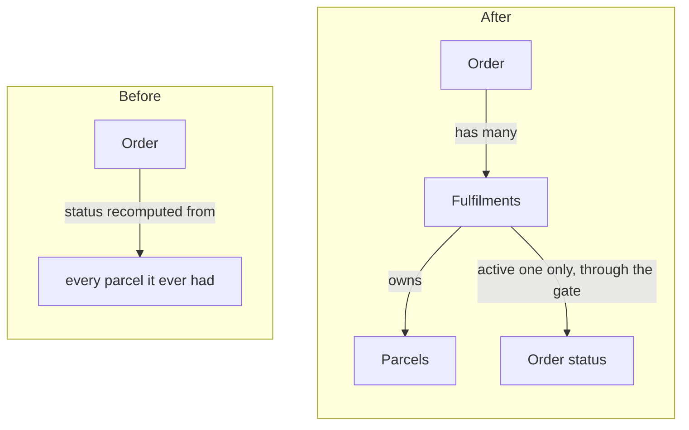

Until now an order *was* its shipment: its status was recomputed from every parcel it ever had, and a re-sent order created a second order. After this PR an order *has fulfilments*: each attempt to deliver it is one record that owns its parcels, and only the active fulfilment can move the order's status, through one gate.

## New terms

- **Fulfilment:** one attempt to deliver an order. It owns its parcels, carrier and status. An order has at most one active fulfilment.
- **The gate:** the one service that may change an order's status.
- **Carrier-accepted:** the carrier has the parcel's manifest with no validation errors.

## How the system works now

| Rule | Before | After |
|---|---|---|
| Who moves an order's status | any parcel update, in about 12 places | only the active fulfilment, through the gate |
| A re-sent order | a second order | a new fulfilment on the same order |
| When an order is Shipped | when the label is printed | only once the carrier accepts the manifest |
| Two writers on one manifest | the second overwrote the first | re-read, merge, retry up to 3 times |

## Decisions you might push back on

1. **Every parcel belongs to a fulfilment.**
   - Why: one code path for status instead of two.
   - Cost: a migration and a deploy gate; old pods must stop before new ones serve.
   - Rejected: supporting parcels with and without a fulfilment.
   - Decided by: tech lead, [ADR-0012](docs/adr/0012-fulfilments.md).
2. **Shipped means carrier-accepted.**
   - Why: support kept answering "Shipped" tickets for parcels the carrier refused.
   - Cost: an order stays Packed until the carrier answers, which can take minutes.
   - Rejected: a separate "Submitted to carrier" status.
   - Decided by: `@ops-lead`, [ADR-0013](docs/adr/0013-shipped-means-accepted.md).
3. **Existing duplicate orders stay as they are.**
   - Why: merging them would guess which payment to keep.
   - Cost: about 40 known duplicates still show twice in reports.
   - Rejected: merging duplicates in the migration.
   - Decided by: agent, not confirmed.

## What changes for people

- **Staff** re-send an order from the order page; it starts a new fulfilment instead of a new order.
- **Customers** see Shipped only once the carrier accepts.
- **API:** `POST /orders/:id/fulfilments` is new. `POST /orders/:id/resend` is removed (0 calls in 30 days).

## For the reviewer

**Look first:**

1. [`order-status.gate.ts`](https://github.com/acme/shop/blob/abc1234/src/orders/order-status.gate.ts): rows 1 and 3, proven by `order-status.gate.spec.ts`.
2. [`fulfilment-start.service.ts`](https://github.com/acme/shop/blob/abc1234/src/fulfilments/fulfilment-start.service.ts): row 2, proven by `fulfilment-start.spec.ts`.
3. [`manifest-writer.ts`](https://github.com/acme/shop/blob/abc1234/src/carriers/manifest-writer.ts): row 4, proven by `manifest-conflict.spec.ts`.
4. [`backfill-fulfilments.ts`](https://github.com/acme/shop/blob/abc1234/src/migrations/backfill-fulfilments.ts) and ADR-0012: the migration.

**Risk and rollout:**

- Deploy gate: drain the label queue, stop old pods, dry run `migrate:fulfilments`, run it, validate, then let new pods serve.
- Roll back the whole PR together.

**Temporarily wrong until fixed by hand:** a carrier that cannot be reached leaves the order Packed until someone presses Retry.

**Not verified by anyone:** the migration on a production-sized database.

**Stack:** bottom of the fulfilments stack ([tracking issue #88](https://github.com/acme/shop/issues/88)); ships with frontend #41.

**Carried fixes:**

- The address formatter joins line 1 and line 2 with a comma, which the manifest writer needs.
